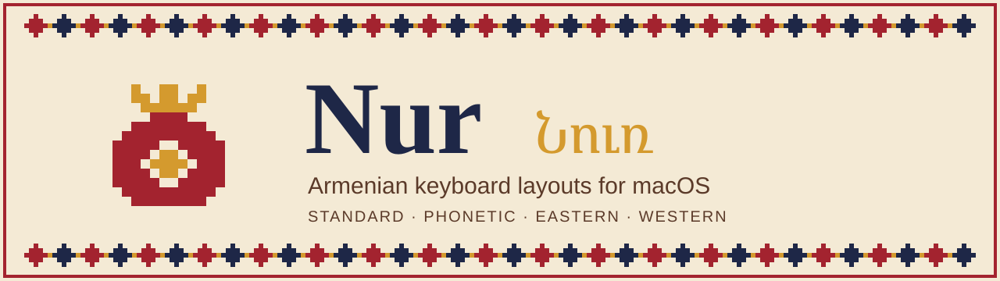

<picture>
  <source media="(prefers-color-scheme: dark)" srcset="branding/banner-dark.svg">
  
</picture>

# Nur — Armenian keyboard layouts for macOS

**Nur** (Նուռ) is the pomegranate, a symbol woven into the borders of Armenian rugs. Its icon is drawn
knot by knot on a 16×16 grid, the way a rug is woven.

Six layouts, ported key for key from the xkeyboard-config `am` layouts:

| Layout | Based on (xkeyboard-config `symbols/am`) |
|---|---|
| Nur Standard | `basic` (default) |
| Nur Phonetic | `phonetic` |
| Nur Phonetic Alt | `phonetic-alt` |
| Nur Eastern | `eastern` |
| Nur Western | `western` |
| Nur Eastern Alt | `eastern-alt` |

The upstream `olpc` and `olpc-phonetic` variants only add a group-switch key that macOS doesn't use. On a Mac
they are identical to Nur Standard and Nur Phonetic Alt, so they aren't shipped separately.

Full key tables: [docs/mapping-tables.md](docs/mapping-tables.md).

## Modifiers

| Keys | Output |
|---|---|
| none / Shift | the Armenian layout, as upstream |
| Caps Lock | capital Armenian letters (punctuation keys unchanged) |
| Option, Shift+Option | US QWERTY Latin characters (macOS addition) |
| Command | US QWERTY, so Cmd+C / Cmd+V / Cmd+Z etc. work |
| Control | standard control characters |

## Install

```bash
scripts/install.sh
```

Then **log out and back in**, open System Settings › Keyboard › Input Sources › Edit… › **+** › Armenian,
and add the layouts you want.

If a layout doesn't appear after logging back in, macOS may be using a stale cache. Delete it and log in again:

```bash
sudo rm -f /private/var/folders/*/*/-Caches-/com.apple.IntlDataCache*
```

If "Use Caps Lock to switch to and from …" is on in Input Sources, Caps Lock switches input sources instead of
typing capitals.

Uninstall: remove the layouts from Input Sources, run `scripts/uninstall.sh`, then log out and back in.

## Compatibility

Keyboard layouts are XML data with no compiled code, so the same files work on Apple Silicon and Intel.
No Rosetta, code signing or admin rights are needed. Built and validated on macOS 26.7 / Apple M4 (typing tests: see TODO below).

Key codes follow ANSI positions. On ISO keyboards macOS may swap the key left of `1` and the key left of `Z`.

## Repository layout

- `Nur.bundle/` — the installable bundle. The `.keylayout` files are maintained by hand.
- `branding/` — SVG sources: `icon-template.svg` (menu-bar icon), `logo.svg`, `banner-light.svg`, `banner-dark.svg`.
- `scripts/build-icons.sh` — rebuilds the menu-bar `.icns` files from `branding/icon-template.svg`.
- `upstream/` — vendored xkeyboard-config source and license (see `upstream/SOURCE.md`). Don't edit.
- `docs/mapping-tables.md` — the transcription worksheet: xkb key → mac keycode → characters, per layout.
- `scripts/validate.sh` — checks the layouts against Apple's DTD, lints the plists, checks ids and `KLInfo` entries.

After editing a `.keylayout`, run `scripts/validate.sh`, reinstall, and log out and back in. Ukelele (free) can
open these files if you'd rather edit them in a GUI.

## Brand

| | |
|---|---|
| Madder red | `#A3232F` |
| Saffron | `#D49A2E` |
| Indigo | `#1E2747` |
| Cream | `#F4EAD5` |
| Walnut | `#5B3A29` |


## Credits

Key mappings come from [xkeyboard-config](https://gitlab.freedesktop.org/xkeyboard-config/xkeyboard-config).
See `LICENSE` and `upstream/COPYING`.

## TODO (manual checks after logging back in)

- [ ] All six layouts appear in Input Sources under Armenian
- [ ] Keyboard Viewer matches `docs/mapping-tables.md` for base / Shift / Caps Lock / Option / Shift+Option
- [ ] Type a test sentence in TextEdit with each layout
- [ ] Cmd+C / Cmd+V / Cmd+Z / Cmd+Q work with every layout
