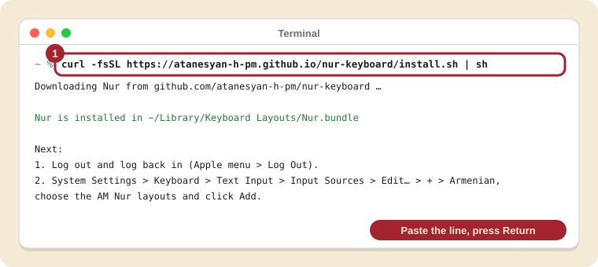
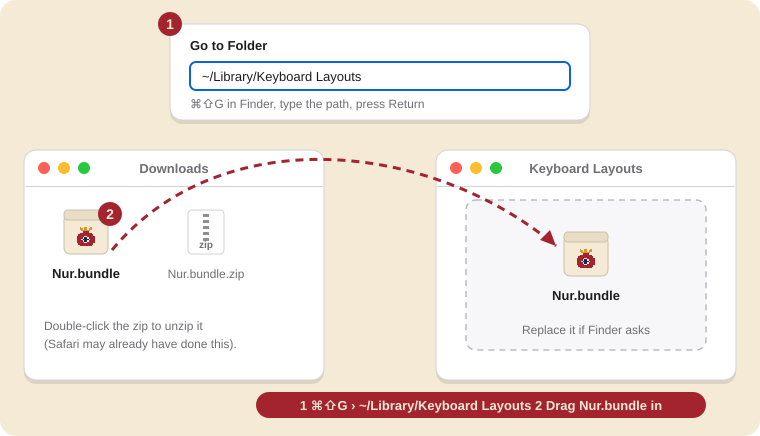
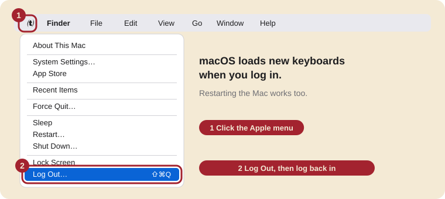
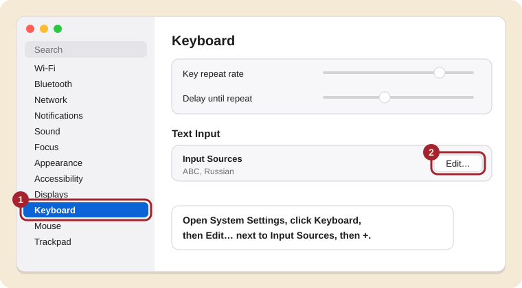
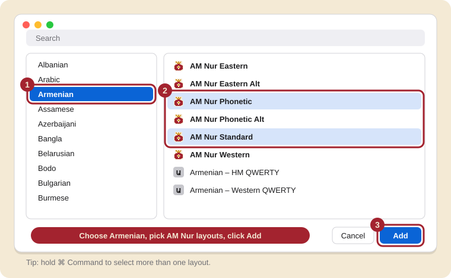
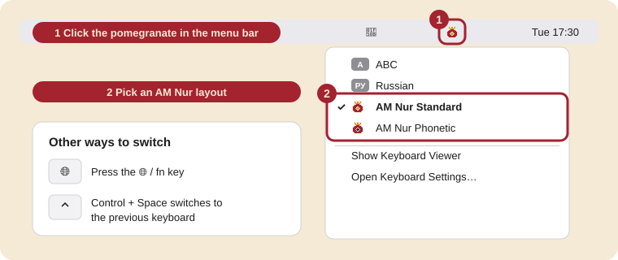
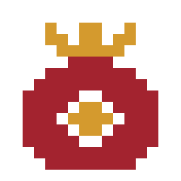

<picture>
  <source media="(prefers-color-scheme: dark)" srcset="branding/banner-dark.svg">
  
</picture>

# Nur — Armenian keyboards for your Mac

**Nur** (Նուռ) means pomegranate, a motif woven into Armenian rugs. Nur adds six Armenian keyboard
layouts to macOS, so you can type Armenian in any app: Mail, Messages, Pages, Word, your web browser and more.

The layouts are copied key for key from the Armenian layouts used on Linux
([xkeyboard-config](https://gitlab.freedesktop.org/xkeyboard-config/xkeyboard-config)), so if you already know
one of them, your fingers will feel at home.

## The six layouts

**New to typing Armenian on a Mac? Start with AM Nur Phonetic:** if you know where the English letters are,
you already know most of it.

| | Layout | Best for |
|---|---|---|
|  | **AM Nur Phonetic**<br>հյ Նուռ Հնչյունային | **Most people.** Armenian letters sit on the English keys that sound alike: ա on A, ս on S, դ on D. |
|  | **AM Nur Phonetic Alt**<br>հյ Նուռ Հնչյունային 2 | Phonetic typists who expect **R** to type ռ (and **8** to type ր). |
|  | **AM Nur Standard**<br>հյ Նուռ Ստանդարտ | Touch typists who learned the classic Armenian typewriter layout (ճ փ բ ս մ on the top row). It's the default "Armenian" layout on Linux. |
|  | **AM Nur Eastern**<br>հյ Նուռ Արևելյան | People coming from the Windows "Armenian Eastern" keyboard, with its G/C mix-up fixed (G types գ). |
|  | **AM Nur Eastern Alt**<br>հյ Նուռ Արևելյան 2 | Fingers trained on Windows XP's "Armenian Eastern" exactly as it was (G types ք, C types գ). |
|  | **AM Nur Western**<br>հյ Նուռ Արևմտյան | Western Armenian speakers coming from the Windows "Armenian Western" keyboard. |

If your Mac's language is Armenian, the layouts show their Armenian names. Still not sure? Add two and try
them, or [see every key](docs/mapping-tables.md) of every layout.

Each layout has its own seed colour in the menu bar, so you can see at a glance which one is on. The
Alt layouts have a stripe through the middle. The icons are easy to see in both light and dark mode.

## Install

You need a Mac with macOS. Both Apple Silicon (M1, M2, …) and Intel Macs work. You don't need an
administrator password.

### 1. Put Nur on your Mac

Pick one of the two ways. Both put the same files in the same place.

#### Option A: Terminal (fastest)

Open the **Terminal** app (in Applications › Utilities), paste this line and press Return:

```bash
curl -fsSL https://atanesyan-h-pm.github.io/nur-keyboard/install.sh | sh
```

It downloads Nur from GitHub and copies the layouts into the `Keyboard Layouts` folder inside your own
Library folder. It only affects your user account. Want to see what it does first? Read
[install.sh](install.sh).



#### Option B: Finder (no Terminal)

1. Download **[Nur.bundle.zip](https://github.com/atanesyan-h-pm/nur-keyboard/releases/latest/download/Nur.bundle.zip)**.
2. Open your **Downloads** folder and double-click **Nur.bundle.zip** to unzip it. Safari may already have
   done this for you.
3. In Finder, press **⌘ Command + ⇧ Shift + G**, type `~/Library/Keyboard Layouts` and press Return.
   If Finder says it can't find the folder, go to `~/Library` instead, choose File › New Folder, and name it
   exactly `Keyboard Layouts`.
4. Drag **Nur.bundle** into that window. If Finder asks, choose **Replace**.



If the layouts don't appear after you log back in (step 2), use Option A once: it does the same thing and also
clears the download flag macOS puts on files from the internet.

### 2. Log out and log back in

macOS only notices new keyboard layouts when you log in. Choose  Apple menu › **Log Out**, then log back in.
Restarting the Mac works too.



### 3. Add the layouts you want



1. Open **System Settings** ( Apple menu › System Settings).
2. Click **Keyboard** in the sidebar.
3. Under **Text Input**, next to **Input Sources**, click **Edit…**.
4. Click the **+** button at the bottom left.
5. Choose **Armenian** in the language list.
6. Select the **AM Nur …** layouts you want (hold Command to select more than one) and click **Add**.

A layout you have already added won't appear in the **+** list again.



## Switching between keyboards



Once you have more than one input source, you can switch in any of these ways:

- **The input menu** in the menu bar (the flag or pomegranate icon near the clock): click it and pick a layout.
- **The 🌐 / fn key**: press it to switch. If it does something else, open System Settings › Keyboard and set
  **Press 🌐 key to** to **Change Input Source**.
- **Control + Space**: switches to the previous input source.

## Special keys

| You hold | You get |
|---|---|
| nothing | the layout's normal characters (lowercase Armenian letters) |
| Shift | the layout's Shift characters (capital Armenian letters and symbols) |
| Caps Lock | capital Armenian letters (number and punctuation keys don't change) |
| Option, or Shift + Option | the same as without Option, or with Shift |
| Command | normal Mac shortcuts: ⌘C copy, ⌘V paste, ⌘Z undo, ⌘Q quit and so on, all in the usual places |
| Control | standard control keys, as on any Mac layout |

## Troubleshooting

**The layouts don't appear in the list after I log in.**
Log out and log back in once more. If they are still missing, macOS may be using an old copy of its keyboard
list. Clear it by pasting this into Terminal:

```bash
curl -fsSL https://atanesyan-h-pm.github.io/nur-keyboard/install.sh | sh -s -- --clear-cache
```

Then log out and log back in.

**After updating, a layout shows up but I can't switch to it.**
An older Nur layout is still turned on under a name that no longer exists. The installer tells you which ones.
Open System Settings › Keyboard › Text Input › Input Sources › **Edit…**, remove the old Nur entries with
**−**, then click **+** › **Armenian** and add the **AM Nur …** layouts again.

**macOS says "The developer can access anything you type".**
macOS shows this message for every keyboard that doesn't come from Apple, and it can't be turned off.
Nur can't see or send what you type: it contains no program code, only tables that say which key types which
letter (the `.keylayout` files in [Nur.bundle](Nur.bundle/Contents/Resources)). It doesn't use the
internet either. You can read every file in this repository.

**Caps Lock switches the keyboard instead of typing capitals.**
In System Settings › Keyboard › Text Input › Input Sources › Edit…, turn off
**Use the Caps Lock key to switch to and from …**.

**One or two keys near the left edge are swapped.**
On keyboards sold outside the US (with a tall Return key), macOS sometimes swaps the key left of **1**
and the key left of **Z**. This comes from macOS, not from Nur.

## Uninstall

Do these in order, so no broken entries are left behind:

1. **Remove the layouts:** open System Settings › Keyboard › Text Input › Input Sources › **Edit…**, select each
   **AM Nur …** layout and click the **−** button.
2. **Delete Nur.** In Terminal, run:

   ```bash
   curl -fsSL https://atanesyan-h-pm.github.io/nur-keyboard/install.sh | sh -s -- --uninstall
   ```

   Or without Terminal: in Finder press **⌘ Command + ⇧ Shift + G**, type `~/Library/Keyboard Layouts`, press
   Return, and drag **Nur.bundle** to the Trash.
3. **Log out and log back in.**

## Compatibility

Nur's layouts are plain data files with no program code inside. That means:

- They work on Apple Silicon and Intel Macs (tested on an Apple M4 with macOS 26.7).
- No Rosetta, code signing or administrator password is needed.

## For developers

Building, testing and changing the layouts is described in [DEVELOPMENT.md](DEVELOPMENT.md).

## Credits and license

The key mappings come from [xkeyboard-config](https://gitlab.freedesktop.org/xkeyboard-config/xkeyboard-config)
(`symbols/am`). Thank you to its authors.

Nur is released under the license in [LICENSE](LICENSE). The mappings taken from xkeyboard-config are also
covered by [upstream/COPYING](upstream/COPYING).


