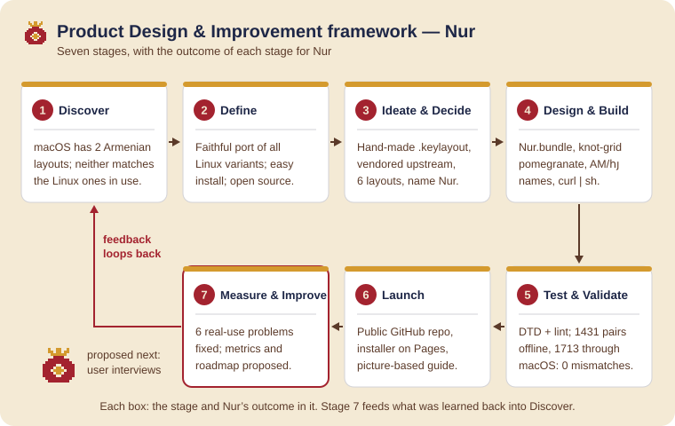
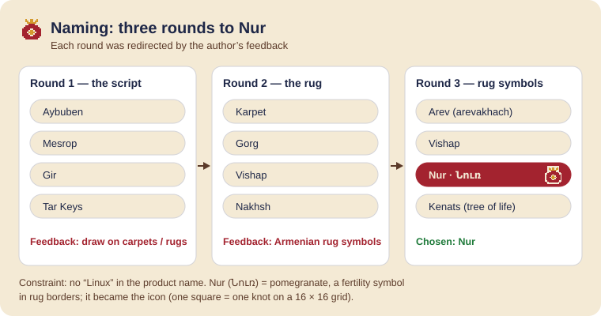
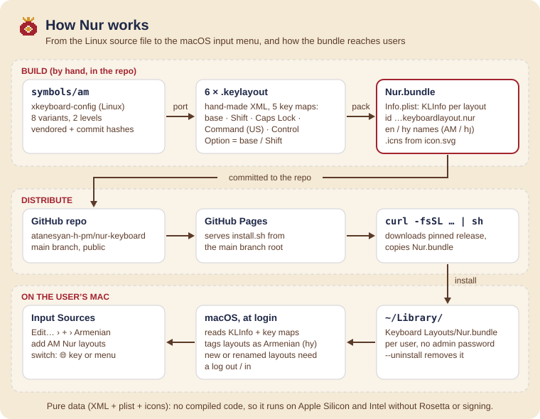
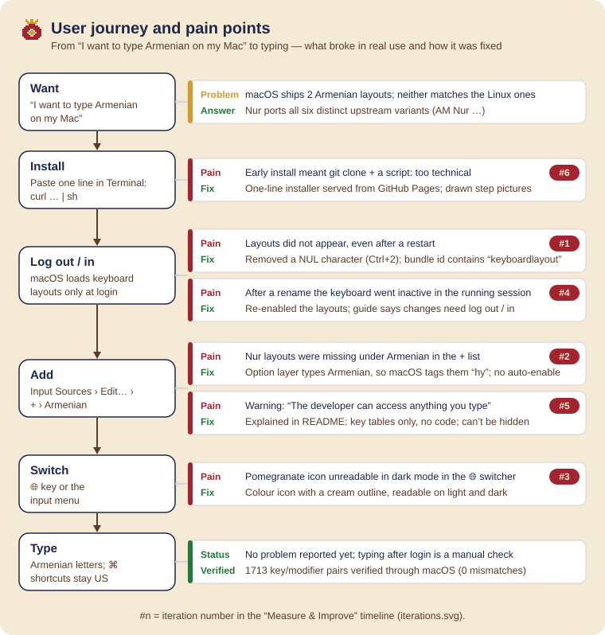
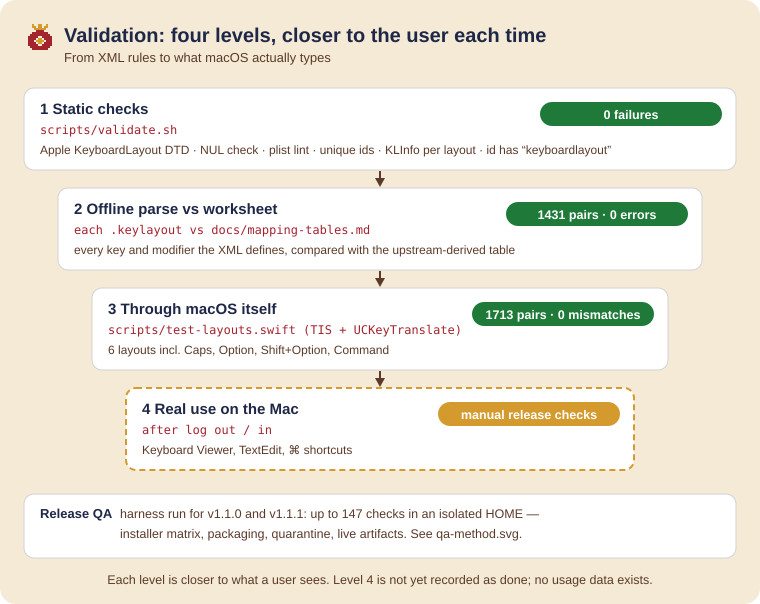
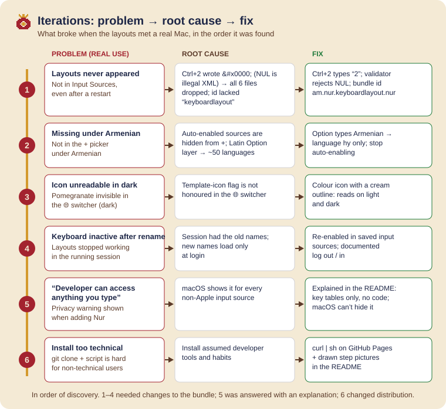

# Nur: a product case study

This case study follows the **Product Design & Improvement framework**: Discover, Define, Ideate & Decide,
Design & Build, Test & Validate, Launch, Measure & Improve.

## Summary

Nur is a free, open-source set of six Armenian keyboard layouts for macOS. It ports the Armenian layouts
that Linux desktops use (from xkeyboard-config `symbols/am`) key for key, so people who learned Armenian
typing on Linux keep their muscle memory on a Mac. The author started it after moving from Linux/GNOME to
a Mac and finding that the two Armenian layouts built into macOS don't match. The product is pure data
(XML key tables, a property list and icons), installs with one Terminal line without an administrator
password, and carries a small brand built around the pomegranate (Նուռ, *nur*), a symbol from Armenian rug
borders. Six problems surfaced only on a real Mac; each was traced to a root cause and fixed, and the
fixes are now encoded in the validator and the maintainer docs.

| Key fact | Value |
|---|---|
| Product | Nur (Նուռ, "pomegranate"): Armenian keyboard layouts for macOS |
| Layouts shipped | 6: AM Nur Standard, Phonetic, Phonetic Alt, Eastern, Western, Eastern Alt |
| Source | xkeyboard-config `symbols/am`, 8 upstream variants, vendored with commit hashes |
| Platform | macOS; Apple Silicon and Intel (no compiled code); built and tested on an Apple M4, macOS 26 "Tahoe" |
| Install | `curl -fsSL https://atanesyan-h-pm.github.io/nur-keyboard/install.sh \| sh`, per user, no admin password |
| Verification | 1431 key/modifier pairs offline, 1713 through macOS `UCKeyTranslate`: 0 errors, 0 mismatches |
| Distribution | Public GitHub repo [atanesyan-h-pm/nur-keyboard](https://github.com/atanesyan-h-pm/nur-keyboard), installer on GitHub Pages |
| Usage data | None yet: the product collects no data and no user research has been done |



## 1. Discover

### Context

The author typed Armenian for years on Linux (GNOME) with the layouts from xkeyboard-config, the project
that defines keyboard layouts for most Linux desktops. After moving to a Mac (Apple M4, macOS 26 "Tahoe"),
the author found that macOS ships only two Armenian layouts, *Armenian – HM QWERTY* and *Armenian – Western
QWERTY*. Neither matches the Linux layouts, so letters sit in different places and years of muscle memory
stop working.

### Problem

There was no faithful macOS version of the Linux Armenian layouts. Anyone moving between the two systems
either relearns a layout or keeps making mistakes.

### Users

| Group | Need | Evidence |
|---|---|---|
| The author (primary user) | Type Armenian on a Mac exactly as on Linux | First-hand; all problems in this study were found in the author's own use |
| People switching from Linux to Mac who type Armenian | Same as above | Assumed from the problem; not yet researched |
| Non-technical Mac users who want an Armenian layout | Install without developer tools, understand macOS settings | A stated goal; shaped the installer and the picture guide |

No interviews, surveys or analytics exist yet. The users beyond the author are hypotheses for the
[Measure & Improve](#7-measure--improve) stage.

### Research

The research was technical: what exactly needs to be ported, and what macOS accepts.

- **Upstream inventory.** `symbols/am` defines eight variants: basic, phonetic, phonetic-alt, eastern,
  western, eastern-alt, olpc and olpc-phonetic. All use only two levels (base and Shift); there is no AltGr
  level and there are no dead keys.
- **Real differences.** `olpc` and `olpc-phonetic` only add a Linux group-switch key. On macOS they would be
  identical to Standard and Phonetic Alt, so six distinct layouts remain.
- **macOS format.** macOS keyboard layouts are `.keylayout` XML files (Apple's KeyboardLayout DTD) inside a
  bundle in `~/Library/Keyboard Layouts`, with per-layout metadata (`KLInfo`) in `Info.plist`. Many of the
  rules macOS applies are undocumented; several were learned in stage 7.

## 2. Define

### Problem statement

People who learned Armenian typing on Linux have no macOS layout that matches it, and installing a custom
layout on macOS is hard for non-technical people.

### Goals

1. **Faithful:** every upstream variant that differs on macOS, key for key.
2. **Easy to install** for non-technical people.
3. **Well branded:** recognisable in the menu bar, with names that fit next to Apple's input sources.
4. **Open source:** public repository, upstream licence respected, maintainable by others.

### Success criteria

| Criterion | How it is checked |
|---|---|
| Every key and modifier matches the upstream table | Automated comparison through macOS: 0 mismatches |
| Layouts appear in System Settings under Armenian | Manual release check after login |
| Shortcuts (Cmd+C, Cmd+V, …) work in every layout | Command layer is US QWERTY; manual release check |
| Install is one step a non-technical person can follow | One-line installer plus a step-by-step picture guide |
| Icon readable in light and dark mode | Checked in the 🌐 switcher and the menu bar |

There are no adoption targets: nothing measures adoption yet (see stage 7).

### Constraints

- **No code.** Only data files (XML, plist, icons): nothing to compile, sign or notarise, and it runs on
  Apple Silicon and Intel without Rosetta.
- **No administrator password.** Install per user into `~/Library/Keyboard Layouts`.
- **macOS loads layouts only at login.** Every install or change needs a log out and log in.
- **Upstream has two levels.** Option, Caps Lock, Command and Control behaviour had to be designed for macOS.
- **No "Linux" in the product name.** The product should stand on its own for Mac users.
- **All brand assets as SVG.** Raster icons are generated from SVG.

## 3. Ideate & Decide

### Options considered

| Decision | Options | Chosen | Why |
|---|---|---|---|
| How to produce the `.keylayout` files | Converter script from xkb; one-time hand translation | **Hand-made, maintained by hand** | Six small, stable layouts; upstream `symbols/am` rarely changes; a converter would be more code to maintain than the layouts themselves. A worksheet ([mapping-tables.md](mapping-tables.md)) keeps the translation reviewable. |
| How to track upstream | Git submodule; vendored copy | **Vendored** copy with commit hashes in [`upstream/SOURCE.md`](../upstream/SOURCE.md) | One file; no submodule step for contributors; licence copied alongside. |
| Which variants to ship | All 8; only those that differ on macOS | **6** | `olpc` and `olpc-phonetic` would be duplicates on macOS. |
| Option layer | Latin (US) characters; same as base/Shift | **Same as base/Shift** (changed after iteration 2) | Matches Linux AltGr behaviour, and keeps macOS from tagging the layouts with ~50 languages. |
| Command layer | Armenian; US QWERTY | **US QWERTY** | Shortcuts such as Cmd+C keep working. |
| Caps Lock | Ignore; capital letters | **Capital Armenian letters** | Expected behaviour on macOS; other keys stay base. |
| Install method | git clone + script; downloadable archive; `.pkg`; one-line `curl \| sh` | **`curl \| sh`** from GitHub Pages | One copy-paste, no admin password, no signing needed; `.pkg` stays on the roadmap. |
| User guide visuals | Real screenshots; drawn pictures | **Drawn SVG pictures** | No personal desktop content exposed; editable when macOS changes. |

### Naming

The name went through three rounds, each redirected by the author's feedback. Names tied to the alphabet
(Aybuben, Mesrop, Gir, Tar Keys) gave way to rug and carpet ideas (Karpet, Gorg, Vishap, Nakhsh), then to
specific Armenian rug symbols (Arev / arevakhach, Vishap, Nur, Kenats / tree of life). **Nur** (Նուռ,
pomegranate) won: it is a fertility symbol found in rug borders, it is short and easy to say in English, and
it gives a simple, recognisable icon.



The layouts follow the pattern macOS uses for other input sources, with a language prefix, as the author
asked: **AM Nur Standard / Phonetic / Phonetic Alt / Eastern / Western / Eastern Alt**, and in an Armenian
interface **հյ Նուռ Ստանդարտ …** (full list in the [README](../README.md#the-six-layouts)).

## 4. Design & Build

### Solution



- **Six `.keylayout` files**, each with five key maps:

  | Map | Modifiers | Output |
  |---|---|---|
  | 0 | none, Option | upstream base level |
  | 1 | Shift, Shift+Option | upstream Shift level |
  | 2 | Caps Lock (+Option) | capital Armenian letters, other keys base |
  | 3 | Command (+any) | US QWERTY, so shortcuts work |
  | 4 | Control (+any) | standard control characters |

- **`Nur.bundle`**: `Info.plist` with a `KLInfo` entry per layout (input source id, language `hy`, colour
  icon), English and Armenian display names (`en.lproj`, `hy.lproj`), and one `.icns` per layout.
- **Installer** ([`install.sh`](../install.sh)): downloads a pinned release tag (verified with SHA-256 when a
  checksum is set), copies `Nur.bundle` to
  `~/Library/Keyboard Layouts`, removes the quarantine flag, prints the next steps. `--uninstall` removes it.
  All code sits inside `main()`, so a partially downloaded script never runs.
- **Maintainer tooling**: [`scripts/validate.sh`](../scripts/validate.sh),
  [`scripts/test-layouts.swift`](../scripts/test-layouts.swift) (every key through macOS), `scripts/build-icons.sh` (SVG →
  `.icns`) and `scripts/svg2png.swift` (SVG → PNG with macOS's own renderer). Details in
  [DEVELOPMENT.md](../DEVELOPMENT.md).

### Brand

| Element | Design |
|---|---|
| Icon | Pixel pomegranate on a 16 × 16 grid; each square stands for one rug knot ([`branding/icon.svg`](../branding/icon.svg)) |
| Banners | Rug-border motif, light and dark versions ([`branding/banner-light.svg`](../branding/banner-light.svg), [`banner-dark.svg`](../branding/banner-dark.svg)) |
| Palette | Madder red `#A3232F`, saffron `#D49A2E`, indigo `#1E2747`, cream `#F4EAD5`, walnut `#5B3A29`: traditional rug dyes |
| Source format | Every asset is SVG; `.icns` files are generated from `icon.svg` |

The icon is drawn in colour with a cream outline rather than as a monochrome template, because macOS does
not honour the template flag in the 🌐 switcher (iteration 3).

### UX of install and setup

The setup has steps that macOS forces and Nur cannot skip: Terminal, log out and in, and adding the layouts
in System Settings. The design goal was to make each step obvious.



- The [README](../README.md) is a user guide, not developer documentation: what Nur is, the six layouts,
  three numbered install steps, switching, special keys, troubleshooting, uninstall.
- Each step has a drawn picture (`docs/images/step-*.svg`) in simplified light-mode macOS UI with red
  numbered callouts in the brand colours. They are drawn, not captured, so no personal desktop content is
  exposed and they can be edited when macOS changes.
- The installer's own output repeats the next two steps, so a user who never opens the README still knows
  what to do.
- Maintainer material lives separately in [DEVELOPMENT.md](../DEVELOPMENT.md).

## 5. Test & Validate



| Level | What | Result |
|---|---|---|
| 1. Static checks | `scripts/validate.sh`: Apple KeyboardLayout DTD (on a masked copy, because `xmllint` can't read XML 1.1 control-character references), NUL check, `plutil -lint`, unique ids, a `KLInfo` entry per layout, bundle id contains `keyboardlayout` | Passes |
| 2. Offline parse vs worksheet | Each `.keylayout` parsed and compared with [mapping-tables.md](mapping-tables.md) | 1431 key/modifier pairs, 0 errors |
| 3. Through macOS | [`scripts/test-layouts.swift`](../scripts/test-layouts.swift): layouts registered with `TISRegisterInputSource`, every key translated with `UCKeyTranslate` (base, Shift, Caps Lock, Option, Shift+Option, Command) | 6 layouts, 1713 pairs, 0 mismatches |
| 4. Real use | Keyboard Viewer, typing in TextEdit, Cmd shortcuts, after log out / in | Listed as manual release checks in [DEVELOPMENT.md](../DEVELOPMENT.md#manual-release-checks) |
| Installer | Piped from the real GitHub Pages URL into a throwaway `HOME` | Installs a bundle identical to the repo's; `--uninstall` removes it |

Level 3 matters most: it tests what macOS actually types, not what the XML says. Levels 1 and 2 passed
while the layouts were still invisible on the Mac (iteration 1), which is why the validator gained checks
for the rules learned later.

**Gaps.** Level 4 is a checklist, not a recorded run.
Nothing has been tested with other people, on ISO keyboards or on other macOS versions.

## 6. Launch

- **Public repository** on GitHub under an MIT-style [licence](../LICENSE), with the upstream licence kept
  alongside the vendored file ([`upstream/COPYING`](../upstream/COPYING)).
- **One-line installer** served from GitHub Pages, which publishes the root of the `main` branch:

  ```sh
  curl -fsSL https://atanesyan-h-pm.github.io/nur-keyboard/install.sh | sh
  ```

  A push to `main` updates what users get. Uninstall is the same line with `-s -- --uninstall`.
- **Per-user install**, no administrator password, no signing or notarisation needed because there is no
  executable code.
- **README as landing page**: banner, plain-language explanation, picture guide.

## 7. Measure & Improve

### What broke in real use, and what changed

Six problems appeared only when the layouts met a real Mac. They are listed in the order found.



| # | Problem | Root cause | Fix |
|---|---|---|---|
| 1 | Layouts did not appear, even after a restart | (a) Control+2 produced `&#x0000;`. NUL is illegal in every XML version, so macOS silently dropped all six files; the project's validator masked control-character references and missed it. (b) macOS only accepts layout bundles whose identifier contains `keyboardlayout`. | Control+2 now outputs "2" and the validator rejects NUL. Bundle id changed from `am.nur.keyboard` to `am.nur.keyboardlayout.nur`; the validator checks it. |
| 2 | Layouts not visible under Armenian in the Input Sources "+" picker | (a) They had been auto-enabled, and macOS hides enabled sources from the "+" list. (b) The Latin Option layer made macOS tag each layout with about 50 languages instead of Armenian. | Option layer types Armenian, so the only language is `hy`. Stopped auto-enabling. |
| 3 | Icon unreadable in dark mode in the 🌐 (fn) switcher | The template-icon flag is not honoured there. | Colour pomegranate with a cream outline, readable on light and dark. |
| 4 | After renaming, the keyboard became inactive in the running session | The session had loaded the old names; new names load only at login. | Re-enabled the six layouts in the saved input-source settings; documented that layout changes need a log out and in. |
| 5 | Warning in Input Sources: "The developer can access anything you type" | macOS shows it for every non-Apple input source. Nur has no code, only key tables, so it cannot read typing. | Answered with an explanation instead of a code change, now in the README's Troubleshooting section; the warning itself cannot be removed. |
| 6 | Install too hard for non-technical users | The first install path was `git clone` plus a script. | One-line `curl \| sh` installer on GitHub Pages, plus drawn step pictures. |

These rules now live in [DEVELOPMENT.md](../DEVELOPMENT.md#macos-rules-learned-the-hard-way) and, where
possible, in `scripts/validate.sh`.

### What to measure next (proposals)

Nur collects no data, so every metric below is a **proposal** and has to come from public signals or
opt-in feedback.

| Question | Proposed signal | Source |
|---|---|---|
| Is anyone finding it? | Stars, clones, unique visitors | GitHub traffic insights |
| Does install work? | Issues about missing layouts or install errors; ratio of such issues to clones | GitHub issues, with an issue template |
| How long does setup take? | Time to first Armenian keystroke, including the log out | Moderated sessions with a few new users |
| Which layouts matter? | Which variants people add and keep | Opt-in survey (the product itself can't report this) |
| Where do people get stuck? | Step where users drop out or ask for help | User interviews, issue labels per install step |

### Roadmap (proposals)

| Idea | Addresses |
|---|---|
| Signed `.pkg` installer | Users who won't use Terminal |
| Homebrew cask | Developers and people who manage apps with Homebrew |
| Testing on ISO keyboards (key codes 10/50 may swap) | Correctness outside ANSI keyboards |
| Real screenshots per macOS version, alongside the drawings | Matching what users actually see |
| Armenian-language user guide | Users who prefer to read in Armenian |
| Interviews with Linux → Mac switchers who type Armenian | Validating the user assumptions from stage 1 |

## Lessons learned

1. **Test through the real system, not the file format.** The XML passed the DTD and the worksheet
   comparison while macOS silently ignored it. Only `UCKeyTranslate` and real use showed what users get.
2. **Silent failures need explicit checks.** macOS gives no error for a NUL character or a wrong bundle id.
   Every rule learned the hard way was added to the validator or the maintainer docs.
3. **Platform metadata is derived from content.** macOS decided the layouts' language from the characters
   they could type. A "helpful" Latin Option layer hid the product from the place users look for it.
4. **Renaming live input sources is disruptive.** Names are part of the installed state; changing them
   broke the running session. Settle names before release.
5. **Design for both appearances from the start.** A platform flag (template icon) can't be relied on;
   a colour icon with an outline works everywhere.
6. **Setup is part of the product.** For a keyboard layout the code is small; most of the user's effort is
   installing, logging out and finding the right settings. One command and drawn pictures did more for
   non-technical users than any key-map change.
7. **Some problems are answered with words.** The "developer can access anything you type" warning can't
   be removed; a clear explanation is the fix, and it is now in the user guide.
8. **Without data, label assumptions.** The only user so far is the author. The next round of the loop
   starts with talking to other users.
